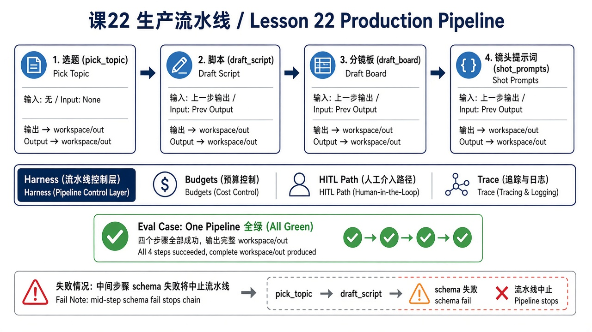
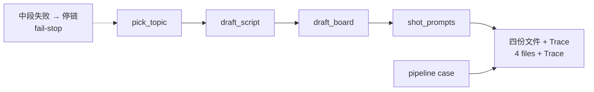

# 22 · 生产流水线串联（Production Pipeline）

> 视角：产品经理 · 图解 + 费曼  
> 日期：2026-11-01（Asia/Shanghai）  
> 对照：课 20 评测桩 · 课 21 接模型 · `labs/07-set-clerk`  
> 工程落点：[`labs/07-set-clerk/`](../../labs/07-set-clerk/)（`run-pipeline` + `case-pipeline`）

## 一句话定义

四个技能不是四个孤立 Demo，而是一条 **有序管线**：上一步产出 = 下一步输入；中段失败默认 **停链**；预算/HITL/Trace 罩 **整条线**；**单技能绿 ≠ 流水线绿**。

## 图解

> 配图：**中英文配套**（CN + EN labels）。风格锁定：纯白底、扁平教材矢量（见仓库 [`skills/harness-diagram/`](../../skills/harness-diagram/SKILL.md)）。





## 本课决策（为什么是这一步）

| 选项 | 是否做 | 理由 |
|---|---|---|
| 顺序锁死：`pick_topic` → `draft_script` → `draft_board` → `shot_prompts` | **做** | 上一步产出是下一步输入；跳步乱写无法验收 |
| 增加 `pipeline` case（四文件 + Trace） | **做** | 单技能全绿不代表整链绿（费曼） |
| 中段失败默认停链 | **做** | 半成品交卷是产品选项；本课默认 fail-stop |
| 整链预算（成本/延迟罩整次流水线） | **做（记着）** | 不只单技能计；可选 `PIPELINE_MAX_MS` |
| 做成片剪辑 / 真发平台 | **不做** | 仍停在内容生产草稿边界 |

## 要点

1. **有序管线**：四技能按固定顺序跑；`run-pipeline.mjs` 编排并写 `traces/case-pipeline.jsonl`。  
2. **单技能绿 ≠ 流水线绿**：四个 case 各自过关，仍要一份 pipeline case 证明整链。  
3. **Fail-stop**：任一步抛错或非 `success` → 停后续步骤；Trace `stop_reason=pipeline_fail`；进程非 0。  
4. **整链证据**：成功时 Trace 含四次 write 路径，且 `step_end` 顺序与产品锁死顺序一致。  
5. **预算罩整条线**：产品按「一次流水线」看成本/延迟；实现上可设 `PIPELINE_MAX_MS`（默认不限制，免拖慢 stub CI）。

## 产品拍板 vs 工程师实现

| 维度 | 产品拍板 | 工程师实现（本课已落） |
|---|---|---|
| 顺序 | 不能跳步 | `ORDER` 数组锁死四步 |
| 验收 | 要整链 case | `cases.json` → `case-pipeline` |
| 失败 | 默认停链，不半成品交卷 | fail-stop + `pipeline_fail` |
| 预算 | 按整次流水线计 | 可选 `PIPELINE_MAX_MS`；Trace 记 `elapsed_ms` |
| 不做 | 真发平台 / 成片剪辑 | 产出仍停在 `workspace/out/` 草稿 |

## 对照工程

- **Lab**：[`labs/07-set-clerk/`](../../labs/07-set-clerk/)  
- **无模型（必须，期望 5/5）**：

```bash
cd labs/07-set-clerk
npm test
```

- 流水线 Trace：`traces/case-pipeline.jsonl`  
- 上一课：[21 · 接模型写稿](./21-model-behind-stubs.md)

## 费曼题

**为什么单技能全绿还不够？流水线评测比单技能多证明什么？**

### 参考答（自学用）

单技能全绿不代表流水线全绿。pipeline case 要一份：证明四份文件齐全，且 Trace 完整（含有序步骤与整链 `stop_reason`）。

## 下一步

- 可收紧 HITL：覆盖「已有稿再改」的确认闸门。  
- 整链成本/延迟实测：接模型后用 `PIPELINE_MAX_MS` / Trace `elapsed_ms` 对照课 17。  
- 预告：项目二（分发文案技能等）**不在本课**；仍不真发平台。  
- 上一课：[21 · 接模型写稿](./21-model-behind-stubs.md) · 路线总览：[README](./README.md)

---

**落地实操弧 · 内容生产** 本课交付：有序管线 + fail-stop + `case-pipeline`（单技能绿 ≠ 流水线绿）。
