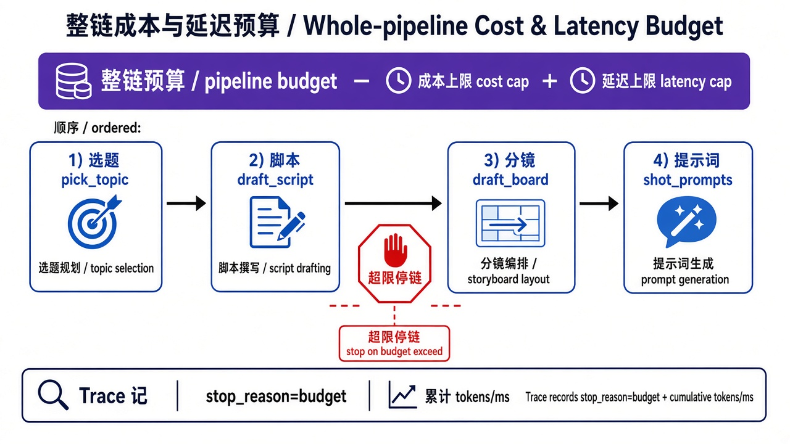
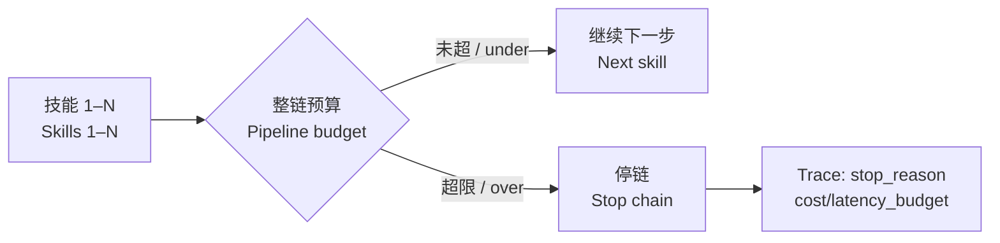

> **旧版参考资料**：已并入第 9 章（[ch09](../../book/harness/chapters/ch09.md)）。

# 23 · 整链成本与延迟预算（Pipeline Cost & Latency Budget）

> 视角：产品经理 · 图解 + 费曼  
> 日期：2026-11-01（Asia/Shanghai）  
> 对照：课 17 单次成本/延迟 · 课 22 生产流水线 · `labs/07-set-clerk`  
> 工程落点：[`labs/07-set-clerk/`](../../labs/07-set-clerk/)（`PIPELINE_*` 整链预算 + `npm run eval:budget`）

## 一句话定义

课 17 管「**单次跑**」的成本/延迟上限；本课把上限罩在 **整条流水线**——累计代理成本 + 墙钟时间。超限就 **停后面的技能**，Trace 写独立的 `stop_reason`（`pipeline_cost_budget` / `pipeline_latency_budget`），**不要**和中段 schema 红混成同一个 `pipeline_fail`。

## 图解

> 配图：**中英文配套**（CN + EN labels）。风格锁定：纯白底、扁平教材矢量（见仓库 [`skills/harness-diagram/`](../../skills/harness-diagram/SKILL.md)）。





## 本课决策（为什么是这一步）

| 选项 | 是否做 | 理由 |
|---|---|---|
| 整链延迟预算 `PIPELINE_MAX_MS` | **做** | 产品按「一次流水线」看墙钟，不是只卡单技能 |
| 整链成本代理 `PIPELINE_COST_UNITS`（每技能 1 unit） | **做** | 教学可复现；以后可换成 tokens |
| 独立 `stop_reason`（勿并入 `pipeline_fail`） | **做** | 产品验收要分清「稿坏了」vs「预算咬住了」 |
| 默认 CI 不设上限（`npm test` 仍 5/5） | **做** | 预算闸门用 `eval:budget` 单独证明 |
| `PIPELINE_MAX_MS=0` 作为确定性延迟 case | **做** | 避免 stub 太快导致 `=1` 抖动 |
| 真云计费 / 付费 API | **不做** | 公开课样本栈：stub + 可选本机 Ollama |

## 要点

1. **单技能上限 ≠ 流水线上限**：多技能串联时，每步都「看起来便宜」仍可能整链超预算。  
2. **两道闸门**：延迟看 `elapsed_ms`；成本看累计 `cost_units`（本课教学代理：启动一步扣 1）。  
3. **停在步前**：检查发生在 **下一步开始之前**；已写完的文件保留，未跑技能不写。  
4. **Trace 留证**：`pipeline_budget` 事件 + `harness_end.stop_reason`；字段含预算类型、已用额度、本会跑的下一技能。  
5. **验收拆开**：`npm test` = 快乐路径 5/5；`npm run eval:budget` = 成本刹 + 延迟刹必须 PASS。

## 产品拍板 vs 工程师实现

| 维度 | 产品拍板 | 工程师实现（本课已落） |
|---|---|---|
| 延迟上限 | 罩整次流水线 | `PIPELINE_MAX_MS`；`>=` 即停；`0` 必在第一步前停 |
| 成本上限 | 罩整次流水线 | `PIPELINE_COST_UNITS`；剩余 `<1` 则停 |
| 教学默认（演示刹） | 成本=2 → 第 3 步前停 | `eval:budget` 注入 `PIPELINE_COST_UNITS=2` |
| Trace | 必须有 stop-on-budget 记录 | `pipeline_cost_budget` / `pipeline_latency_budget` |
| CI | 不设预算时仍绿 | `npm test` 不设 env；预算另跑 |

## 对照工程

- **Lab**：[`labs/07-set-clerk/`](../../labs/07-set-clerk/)  
- **快乐路径（必须 5/5）**：

```bash
cd labs/07-set-clerk
npm test
```

- **预算闸门（必须 PASS）**：

```bash
cd labs/07-set-clerk
npm run eval:budget
# 等价于：成本 PIPELINE_COST_UNITS=2 → 停在 draft_board 前
#         延迟 PIPELINE_MAX_MS=0 → 停在 pick_topic 前
```

- 流水线 Trace：`traces/case-pipeline.jsonl`  
- 上一课：[22 · 生产流水线串联](./22-production-pipeline.md) · 对照单次预算：[17 · 成本与延迟](./17-cost-latency.md)

## 费曼题

**为什么流水线预算不能只抄课 17 的「单技能上限」？超限时 Trace 必须留下什么，产品才能验收？**

### 参考答（自学用）

因为流水线有多技能。Trace 要有 stop-on-budget 记录（独立 `stop_reason` + 预算类型 / 已用量 / 本会跑的下一技能），产品才能验收「闸门真的咬住」，而不是和中段失败混成一锅。

## 下一步

- HITL：覆盖「已有稿再改」须确认；拒绝则停（课 24）。  
- 失败注入与半成品降级是否允许：产品选项（课 25 预告）。  
- 上一课：[22 · 生产流水线串联](./22-production-pipeline.md) · 路线总览：[README](./README.md)

---

**落地实操弧 · 内容生产** 本课交付：整链成本/延迟预算闸门 + Trace 独立 `stop_reason` + `eval:budget`。
